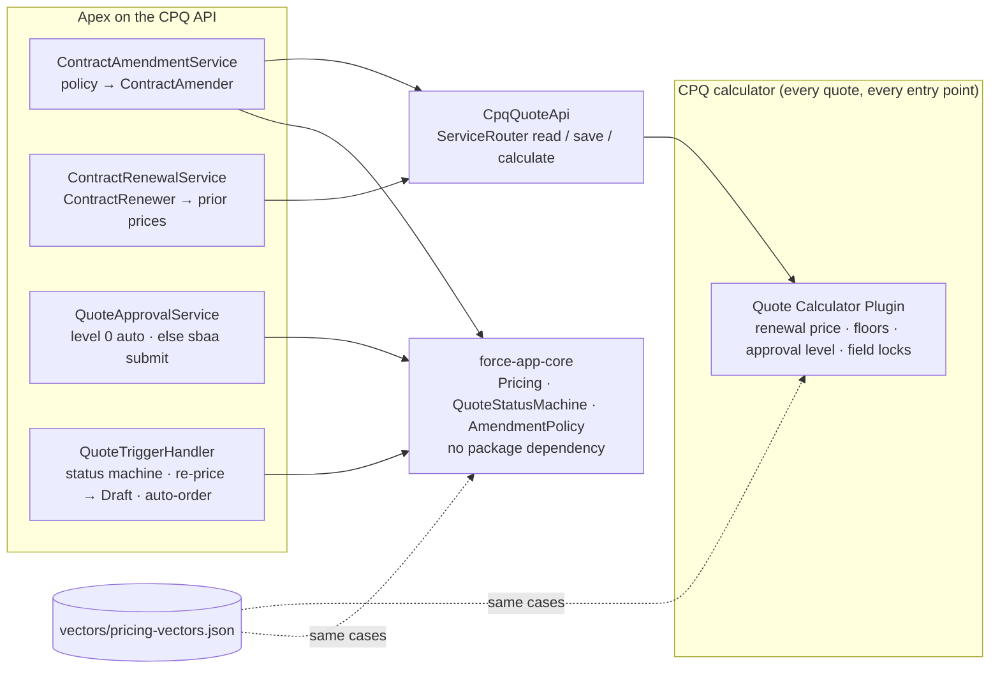

# cpq-q2c-extensions

> Part of [revenue-systems](../README.md). Run every command from `cpq-q2c-extensions/`. CI: [`cpq-q2c-extensions.yml`](../.github/workflows/cpq-q2c-extensions.yml), which runs when this folder changes.

Custom code written against the **Salesforce CPQ package** (SBQQ + Advanced Approvals) for the parts
of quote-to-cash that configuration alone doesn't handle well: renewal pricing, floor-price
protection, approval routing, quote and contract lifecycle enforcement, legal terms review,
renewal notices, and amendments and renewals driven from Flow.



## What's here

| Area | Code | What it does |
|---|---|---|
| **Pricing data model** | [docs/DATA_MODEL.md](docs/DATA_MODEL.md), `force-app-cpq/.../objects` | Product → price book → price rules / discount schedules → quote → order → contract → subscription, plus the custom fields this code adds (including a Product2 → quote line *twin field*) |
| **Quote calculation** | [`qcp/src/quote-calculator-plugin.js`](qcp/src/quote-calculator-plugin.js) | `onBeforeCalculate`: renewal price = min(list, prior × (1+cap)), or the prior price if grandfathered. `onAfterCalculate`: floor price per line, breach flag, max effective discount, **Approval_Level__c** + reasons. `isFieldEditable`: locks discounts on grandfathered lines |
| **Quote API** | `CpqModels`, `CpqQuoteApi`, `CpqSaveCallback` | `SBQQ.ServiceRouter` read / save / calculate (async with callback) / ContractAmender / ContractRenewer. Code never writes line prices directly |
| **Lifecycle** | `QuoteTriggerHandler`, `QuoteStatusMachine` | Status transitions enforced from any entry point. An approved quote whose approval level *rises* on re-price goes back to Draft. Accepted → Ordered automatically |
| **Approval automation** | `QuoteApprovalService` | Level 0 auto-approves; level ≥ 1 calls `SBAA.ApprovalAPI.submit`, and Advanced Approvals rules route on the level |
| **Amendments** | `ContractAmendmentService`, `AmendmentPolicy` | Flow action: policy first (no mid-term decreases, effective date in term, product on contract), then ContractAmender → set quantities → save → calculate |
| **Renewals** | `ContractRenewalService` | Flow action: ContractRenewer, then each renewed subscription's net price and grandfather flag go onto the renewal lines. The QCP prices them |
| **Quoting help** | `CoTermEstimator` | Flow action: co-termed add-on estimate before any amendment quote exists |
| **Contract lifecycle** | `ContractLifecycle`, `ContractLifecycleHandler` | Draft → In Negotiation → Signed → Active → Expiring → Renewed / Expired / Terminated, enforced on update. Signing stamps the signed date; terminating needs a reason |
| **Legal terms review** | QCP `termsReview`, `ContractTerms` | Non-standard liability cap, auto-renew off, or termination for convenience → `Legal_Review_Required__c` and a higher approval level (uncapped liability → CFO) |
| **Renewal notices** | `RenewalNotice`, `RenewalNoticeJob` | Nightly: once the window opens (notice date − 30 days), auto-renew contracts get a renewal quote via the CPQ Contract Renewer; others get one owner task; unrenewed contracts expire after the end date |

**Design rule:** Apex gathers facts; the calculator sets prices. Renewal and floor logic lives in the
QCP, so a rep who recalculates a quote later gets the same answer as the automation that created it.
See [docs/DESIGN.md](docs/DESIGN.md) for configuration vs code decisions.

## Verified here vs needs an org

| Piece | Verified how | Status |
|---|---|---|
| QCP logic + hooks | `npm test`: 61 node tests on CPQ-shaped quote models + shared vectors | ✅ passing |
| Contract lifecycle + notice rules | Same vectors run against `reference/clm.js` in node | ✅ passing |
| Shared vectors ↔ Apex static resource | `npm run vectors:check` (byte-identical) | ✅ |
| All Apex (22 files) | `npm run apex:syntax`: open-source Apex grammar parser | ✅ parses. Syntax only, no type resolution |
| `force-app-core` Apex + tests | Deploy to **any** org; `PricingVectorsTest` runs the same vectors, `ContractLifecycleTest` does real Contract DML | ⏳ needs an org (a Developer Edition is enough) |
| `force-app-cpq` Apex + tests | Deploy to a **CPQ + Advanced Approvals** org (e.g. a CPQ trial or Trailhead CPQ playground) | ⏳ not yet compiled against the package |

## Run

```bash
npm install
npm test                    # QCP + shared vectors
npm run apex:syntax         # parse every Apex file
npm run vectors:check
npm run qcp:record          # build/qcp-record.json for sf data import tree
```

Deploy:
```bash
sf project deploy start --source-dir force-app-core --target-org <any-org> --test-level RunSpecifiedTests --tests PricingVectorsTest --tests ContractLifecycleTest
sf project deploy start --source-dir force-app-cpq  --target-org <cpq-org>  --test-level RunSpecifiedTests --tests QuoteTriggerHandlerTest --tests RenewalNoticeJobTest
sf data import tree --files build/qcp-record.json --target-org <cpq-org>
```
Then set CPQ Settings → Plugins → Quote Calculator Plugin, and build the Advanced Approvals rules described in [docs/LIFECYCLE.md](docs/LIFECYCLE.md).
