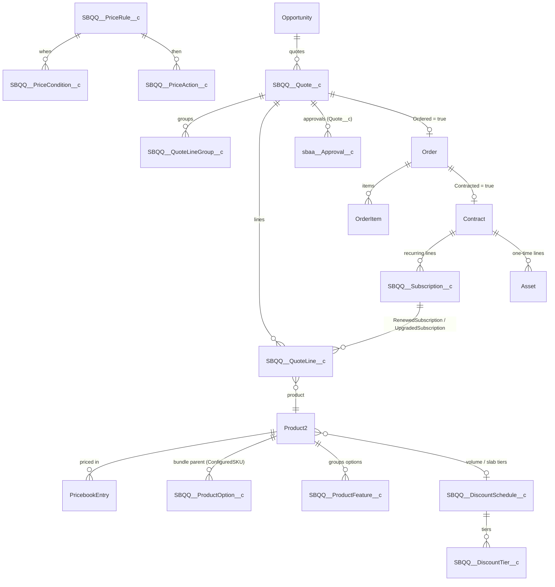

# Product, pricing and quote-to-cash data model

## Price waterfall (per quote line)

List price (price book) → **special price** (contracted / QCP renewal price) → regular price →
volume tiers (discount schedule) → customer price (additional discount) → partner and distributor
discounts → **net price**. The QCP sets the special price *before* calculation (renewals) and reads the
net price *after* it (floors, approval level), so it works with every layer CPQ applies between them.

## Fields this project adds

| Object | Field | Set by | Used by |
|---|---|---|---|
| Product2 | `Max_Discount_Pct__c` | Pricing team | Twin field → quote line |
| SBQQ__QuoteLine__c | `Max_Discount_Pct__c` | CPQ twin-field copy on add | QCP floor price |
| SBQQ__QuoteLine__c | `Floor_Price__c`, `Floor_Breach__c` | QCP onAfterCalculate | Approval level, reporting |
| SBQQ__QuoteLine__c | `Prior_Net_Price__c`, `Grandfathered__c` | ContractRenewalService | QCP renewal price, field locks |
| SBQQ__Quote__c | `Max_Line_Discount__c`, `Approval_Level__c`, `Approval_Reasons__c` | QCP onAfterCalculate | Advanced Approvals rules, trigger |
| SBQQ__Quote__c | `Renewal_Cap_Pct__c` | ContractRenewalService (from Account) | QCP renewal price |
| SBQQ__Subscription__c | `Grandfathered__c` | Migration decisions | Renewal service |
| Account | `Renewal_Cap_Pct__c` | Contract terms | Renewal service |
| sbaa__Approval__c | `Quote__c` (lookup) | Advanced Approvals setup | `SBAA.ApprovalAPI.submit` |
| SBQQ__Quote__c | `Liability_Cap__c`, `Auto_Renew__c`, `Termination_For_Convenience__c` | Rep / Legal on the quote | QCP terms review |
| SBQQ__Quote__c | `Legal_Review_Required__c` | QCP onAfterCalculate | Legal approval rule |
| Contract | `Lifecycle_Status__c` | Users + `RenewalNoticeJob`, enforced by trigger | Lifecycle reporting |
| Contract | `Notice_Days__c`, `Auto_Renew__c` | Contracting (from the quote's terms) | `RenewalNotice` |
| Contract | `Renewal_Quote_Created__c`, `Termination_Reason__c` | Renewal job / user | Idempotency, audit |

**Twin fields:** CPQ copies a Product2 field to the quote line when the API names match, at no cost.
That keeps `Max_Discount_Pct__c` on the line without a formula that would need the product loaded.
