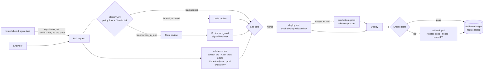

# gtm-release-control

> Part of [revenue-systems](../README.md). This project is the repository's release pipeline: its workflows (`classify`, `gate`, `validate-sf`, `app-tests`, `deploy`, `rollback`, `agent-task`) live in [`.github/workflows/`](../.github/workflows/) and govern every pull request in the repository. Run local commands from `gtm-release-control/`.

An AI-first CI/CD pipeline for a production Salesforce org and the internal apps around it.
Each change gets routed into one of three lanes: **agentic**, **AI-assisted**, or **human-in-the-loop**.
Every deploy writes its own audit evidence.

I've run release pipelines built for humans. This one is built for agents and humans working
side by side, and it assumes that any automated decision can be wrong.



## Lanes

| Lane | Typical change | Gates |
|---|---|---|
| `agentic` | Labels, layouts, reports, docs, test-only changes; small | CI green |
| `ai_assisted` | Apex, LWC, Flows, custom-app code | CI green + 1 non-author review |
| `human_in_loop` | Profiles, permission sets, sharing, Opportunity/Quote/CPQ, destructive changes, the pipeline itself | CI green + review + business sign-off by a listed approver (not the author, not the only reviewer) + release approver on the production environment |

**How a lane is chosen** ([`classifier/`](classifier/)): `lane = max(policy floor, Claude assessment, current lane, escalation)`.

- **Policy floor**: hard path rules in [`policy.yaml`](classifier/policy.yaml). An unmapped path never defaults to agentic.
- **Claude assessment**: reads the diff and scores blast radius. It can **raise** the lane, never lower it, so a prompt-injected diff can't argue its way down.
- **Fail closed**: missing key, API error, refusal, non-JSON output, or a diff too large to send whole → `human_in_loop`.
- **Only up**: a lane never drops on re-push. Two failed validations bump it one lane.
- **Kill-switch**: `AGENT_LANE_ENABLED=false` stops agents from starting and sends agentic PRs to `ai_assisted`.

## Failure design

| What goes wrong | What happens |
|---|---|
| A PR edits the classifier to route itself as agentic | Classifier and gate run from the **base** branch, and the guardrail paths are floored at human_in_loop |
| Someone hand-edits the lane label | Gate only accepts a lane label applied by the classifier's GitHub App |
| The agent tries to deploy | The agent job holds no Salesforce credentials. Its settings deny `sf`, merge, label, and workflow commands |
| A deploy passes but breaks production | Smoke tests fail → reverse-delta rollback → deploy freeze issue → revert PR, all in the same run |
| Two deploys race | `concurrency: production-deploy`, never cancelled midway |
| Evidence gets edited after the fact | Hash-chained ledger on a protected branch. `verify` finds the first broken link |
| Validated deploy ID expired | Falls back to a delta deploy with `RunLocalTests` |

Read [docs/DESIGN.md](docs/DESIGN.md) for rationale, and for what rollback **can't** undo.

## Layout

```
.github/workflows/   classify · gate · validate-sf · app-tests · deploy · rollback · agent-task
.github/actions/     sf-setup (CLI + JWT) · ledger-append
classifier/          policy.yaml + classify.py (Claude, structured output, fail-closed)
gate/                check_gate.py: separation of duties, lane-label provenance
evidence/            ledger.py: append-only hash chain
metrics/             lead time · change failure rate · lane share · policy gaps
agents/              agent permissions + scope (what agents never do alone)
infra/               Terraform: branch protection, environments, kill-switch variables
force-app/           sample Apex trigger + handler + bulk tests (revenue guard)
docs/                DESIGN · AUDITOR · BUSINESS · TOOLS_BOUNDARY
```

## Run locally

```bash
python3 -m venv .venv && .venv/bin/pip install -r requirements.txt -r requirements-dev.txt
.venv/bin/python -m pytest -q
.venv/bin/python classifier/classify.py --base HEAD~1 --head HEAD --offline
```

The Apex code needs a Salesforce Dev Hub. See the setup checklist in [docs/DESIGN.md](docs/DESIGN.md#setup).

## Status

Python components are unit-tested: the classifier, gate, ledger, metrics, and coverage gate. Workflows pass `actionlint`.
The Salesforce and GitHub workflows still need a run against a real Dev Hub and repository
settings. That's the next milestone.

## What I'd change next

- Pin every third-party action to a commit SHA, not a tag.
- Mirror the ledger head hash to WORM storage (S3 Object Lock) so the whole chain can't be rewritten.
- A Slack app for business sign-off that shows the evidence pack and applies `signoff:business` for the approver.
- A classifier eval set of labeled historical PRs, tracking the false-agentic rate as the headline number.
- A data-backup step before any `human_in_loop` deploy that touches revenue objects, since metadata rollback doesn't restore data.
