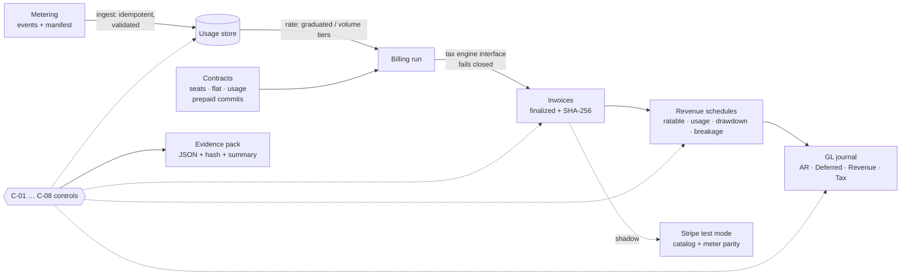

# meter-to-revenue

> Part of [revenue-systems](../README.md). Run every command from `meter-to-revenue/`. CI: [`meter-to-revenue.yml`](../.github/workflows/meter-to-revenue.yml), which runs when this folder changes.

The money path after the quote is signed: **usage events → rating → invoices → tax → revenue
recognition → general ledger**, with a SOX-style control at every handoff and an evidence pack per period.



## What it covers

| Area | Implemented |
|---|---|
| **Usage-based billing** | Idempotent event ingestion (event id = idempotency key), manifest reconciliation, late events billed next period, graduated and volume tiers |
| **Subscription billing** | Monthly and annual-in-advance seats, flat fees, anniversary billing |
| **Commits / credits** | Prepaid commit invoiced up front, drawn down by usage (shown as list price + credit applied), overage once exhausted, breakage at contract end |
| **Tax** | Provider interface (rate-table stand-in for Avalara / Anrok / Stripe Tax), per-line determination, exemption certificates, fails closed on unknown jurisdiction or code |
| **Revenue** | Ratable daily recognition with remainder to the last period, usage as consumed, commit drawdown releases deferred revenue, breakage; deferred revenue roll-forward |
| **GL** | Double-entry journal for invoices and recognition; trial balance |
| **SOX controls** | 8 automated controls with objectives, preventive/detective nature, exceptions, and a hashed evidence pack |
| **Stripe** | Shadow sync to **test mode only**: products, tiered metered prices on Billing Meters, customers; catalog parity and meter-total parity checks |

## Run the example

```bash
python3 -m venv .venv && .venv/bin/pip install -r requirements.txt -r requirements-dev.txt
.venv/bin/python -m m2r demo example --out out        # two periods, end to end
.venv/bin/python -m pytest -q
```

The [example](example/README.md) has four contracts across two months. March passes all 8 controls.
April fails two **planted** issues: a usage batch missing an event, and a self-approved contract change.

```
deferred 2027-03: 0 + 14000.00 − 4659.84 = 9340.16
deferred 2027-04: 9340.16 + 800.00 − 4140.16 = 6000.00     ← exactly Acme's unrecognized annual seats
```

Step by step against a persistent database:

```bash
.venv/bin/python -m m2r ingest   example example/usage/batch-2027-03 --db m2r.db
.venv/bin/python -m m2r bill     example 2027-03 --db m2r.db --out out/invoices
.venv/bin/python -m m2r revenue  example 2027-03 --db m2r.db
.venv/bin/python -m m2r controls example 2027-03 --db m2r.db --changes example/changes.yaml --out out/evidence
```

## Stripe shadow billing (your test account)

```bash
.venv/bin/pip install -r requirements-stripe.txt
export STRIPE_API_KEY=sk_test_...          # live keys are refused
.venv/bin/python -m m2r stripe-sync example --ids stripe_ids.json
.venv/bin/python -m m2r stripe-parity example --ids stripe_ids.json --db m2r.db \
    --start 2027-03-01T00:00:00Z --end 2027-05-01T00:00:00Z --push
```

Stripe only accepts meter events with recent timestamps, so the dated example won't push as-is.
Ingest fresh events for a live run. The adapter is unit-tested against a fake Stripe module; it has
**not yet been run against a live Stripe test account**. See [docs/STRIPE.md](docs/STRIPE.md).

## Docs

- [docs/CONTROLS.md](docs/CONTROLS.md): control matrix (objective, risk, nature, evidence), written for an auditor
- [docs/ACCOUNTING.md](docs/ACCOUNTING.md): recognition policy, journal patterns, worked example tied to the numbers above
- [docs/STRIPE.md](docs/STRIPE.md): book → Stripe mapping, Metronome/Zuora equivalents, what isn't built

## Not production

The example data, prices, and tax rates are illustrative, not tax or accounting advice. The recognition
policy is simplified: there's no SSP allocation across bundled obligations, and breakage is recognized at
expiry rather than estimated. Each simplification is stated in [docs/ACCOUNTING.md](docs/ACCOUNTING.md).
