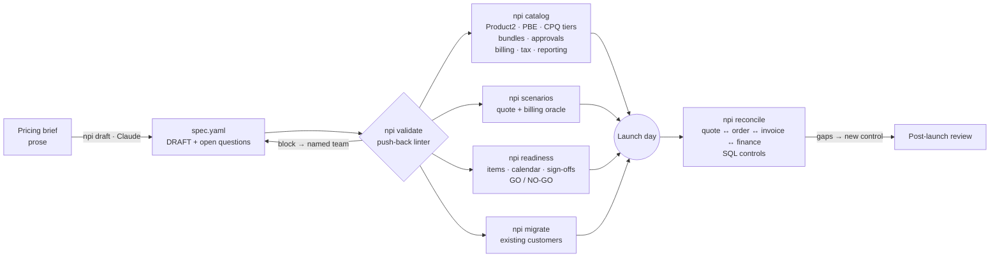

# npi-launch-kit

> Part of [revenue-systems](../README.md). Run every command from `npi-launch-kit/`. CI: [`npi-launch-kit.yml`](../.github/workflows/npi-launch-kit.yml), which runs when this folder changes.

Launching a new product or price is a change to many systems: catalog, quoting, approvals,
contracts, billing, tax and finance reporting. This kit runs that change from **one pricing spec**,
from the first pricing conversation to the first invoice. Every downstream artifact is derived
from the spec and checked against it.



## What each step answers

| Command | Question | Output |
|---|---|---|
| `validate` | Can this pricing be quoted, billed, taxed and reported cleanly? | Findings, each naming the team to push back to |
| `catalog` | What exactly changes in each system? | Load-ready CSVs + a change plan diffed against the live catalog |
| `scenarios` | Do quotes and invoices come out the way Finance expects? | Pass/fail on totals, first invoice and approval route |
| `readiness` | Are we ready, and who is late? | Checklist derived from the spec, calendar, sign-offs, GO/NO-GO |
| `migrate` | What happens to existing customers? | Per-subscription plan with uplift, co-term amendments and flags |
| `reconcile` | After go-live, do all systems agree? | 8 SQL controls; every failing row listed |
| `draft` / `propose-scenarios` | Can Claude shorten the cycle? | Drafts and edge cases, always checked by the steps above |

## Try it

```bash
python3 -m venv .venv && .venv/bin/pip install -r requirements.txt -r requirements-dev.txt
E=examples/insights-launch
.venv/bin/python -m npi validate  $E/spec.yaml
.venv/bin/python -m npi scenarios $E/spec.yaml $E/scenarios.yaml
.venv/bin/python -m npi catalog   $E/spec.yaml --current $E/current_catalog.csv --out build/catalog
.venv/bin/python -m npi readiness $E/spec.yaml $E/tracker.yaml --today 2027-02-20
.venv/bin/python -m npi migrate   $E/spec.yaml $E/subscriptions.csv --as-of 2027-03-01
.venv/bin/python -m npi reconcile $E/spec.yaml $E/post_launch
.venv/bin/python -m pytest -q
```

The example is a fictional launch with four pricing models: per-seat, graduated usage tiers,
a 3-year committed ramp with drawdown and overage, and a flat add-on. It includes a bundle,
a discount approval matrix, and a legacy SKU being retired. The post-launch exports have
[six planted defects](examples/insights-launch/post_launch/README.md), and `reconcile` catches all of them.

## Salesforce

`force-app/` holds the declarative pieces that enforce the launch rules in the org itself:

- `Product2` fields: `Billing_Model__c`, `Tax_Code__c`, `Launch_Stage__c`, `End_of_Sale_Date__c`
- Validation rule: an active product must have a billing model and, unless it's a bundle parent, a tax code
- Validation rule: moving a product to End of Sale requires an end-of-sale date
- Validation rule: a retired product can be renewed but can't be added to new business

Deploy it with the same governed pipeline as [gtm-release-control](../gtm-release-control).
Catalog CSV columns match these field names. CPQ (`SBQQ__*`) columns assume the Salesforce CPQ
package; confirm them against your installed version before loading.

## Docs

- [docs/PLAYBOOK.md](docs/PLAYBOOK.md): the NPI process. Intake, readiness, sign-offs, calendar, launch, first bill run, post-launch review
- [docs/PRICING_MODELS.md](docs/PRICING_MODELS.md): how each model flows into bookings, invoicing, tax and revenue recognition, the source of truth for each part, and worked examples behind the scenario suite
- [docs/AI_CHECKS.md](docs/AI_CHECKS.md): where Claude is used and how its output is checked
