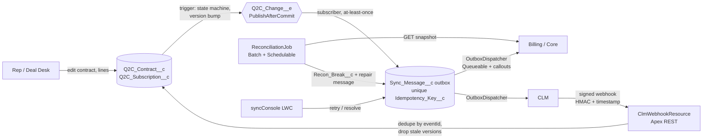

# q2c-integration-hub

> Part of [revenue-systems](../README.md). Run every command from `q2c-integration-hub/`. CI: [`q2c-integration-hub.yml`](../.github/workflows/q2c-integration-hub.yml), which runs when this folder changes.

An in-house quote-to-cash integration layer on Salesforce. It keeps contracts and subscriptions
consistent across **Salesforce**, a **CLM** (contract lifecycle management) system, and a
**Billing** system when those systems retry, duplicate, reorder, time out, or drift. Built with Apex,
Platform Events, Queueable and Batch Apex, an Apex REST webhook, and a Lightning Web Component. A
Python reference model checks the design against thousands of randomized failure scenarios.



## What each failure does

| What goes wrong | What the system does | Where |
|---|---|---|
| Save rolls back after the change was "sent" | Nothing was sent: the event is `PublishAfterCommit`, so it exists only if the save commits. A failed publish fails the save. | `Q2CContractTriggerHandler` |
| Same Platform Event delivered twice, or late | The second insert hits the unique `Idempotency_Key__c` and counts as already queued | `OutboxService` |
| Two quick edits (v4, v5) | Both events snapshot the *current* contract (v5) and collapse into one message; if v4 was already queued it's superseded before sending | `OutboxService`, `OutboxDispatcher` |
| Billing times out, or applied it but the response was lost | Retry with the **same** `Idempotency-Key`; Billing replays its first answer instead of applying twice | `RetryPolicy`, contract `q2c.contract.v1` |
| 429 / 5xx / outage | Retry with doubling backoff (30s to 1h) plus jitter, so recovered targets aren't stampeded | `RetryPolicy` |
| 400 / 401 / 422 | Dead immediately: resending identical bytes can't succeed. Visible in the console. | `RetryPolicy` |
| An old version arrives after a newer one | Billing answers 409, and the message is marked Superseded, never retried | `RetryPolicy` |
| CLM webhook redelivered | Unique `clm-in:<eventId>` key returns `200 duplicate` without touching the contract | `ClmWebhookResource` |
| CLM webhooks out of order | `agreementVersion` <= stored version → `Ignored_Stale` | `InboundApplier` |
| CLM signs a contract we already cancelled | State machine refuses it; message is Dead for a person to decide | `ContractStateMachine` |
| Forged or replayed webhook | HMAC-SHA256 over `timestamp.body`, 5-minute window, constant-time compare; blank secret rejects everything | `WebhookSignature` |
| Someone edits Billing directly | Nightly reconciliation records a `Recon_Break__c` and queues a repair under a fresh key | `ReconciliationJob` |
| Downstream is misbehaving | Kill switch (`Outbound_Enabled__c`) stops sending; messages keep queueing and drain when it's turned back on | `SyncConfig` |
| Governor limits | Callouts before DML; stop before 100 callouts or ~120s; chain the next Queueable, or delay it to the next retry time | `OutboxDispatcher` |

## Layout

```
force-app/main/default/
  objects/        Q2C_Contract__c, Q2C_Subscription__c, Sync_Message__c, Recon_Break__c,
                  Q2C_Change__e (Platform Event), Q2C_Integration_Settings__c (protected)
  classes/        state machine, outbox, dispatcher, transport, webhook, reconciliation, console
  triggers/       contract, subscription, Platform Event subscriber
  lwc/            syncConsole (record page), syncConsoleUtils
  permissionsets/ Q2C_Sync_Operator (+ custom permission)
contracts/        JSON Schema data contracts for every payload on the wire
vectors/          sync-vectors.json: rules run by Apex AND Python
sim/              Python reference model, fake Billing + CLM, chaos tests
docs/             DESIGN, SEQUENCES, DATA_CONTRACTS, RUNBOOK
```

## Run it

```bash
npm ci
npm run check                      # Apex syntax, metadata cross-check, vectors, LWC Jest
cd sim && pip install -r requirements-dev.txt
python -m unittest discover -s tests -t .
python -m q2c_sim 500              # 500 randomized scenarios, prints what was absorbed
```

Sample from `python -m q2c_sim 200`: 9,326 requests, 1,652 same-key retries, 1,046 superseded
messages, 259 duplicate webhooks, **0 double applies in Billing, 0 billable contracts missing,
0 reconciliation drifts after drain**.

## Verification status

| Check | Status |
|---|---|
| Apex: 26 classes and triggers parse (open-source Apex grammar) | ✅ in CI |
| Metadata: every XML well-formed; every `__c` / `__e` / `__r` name used in Apex and LWC is defined | ✅ in CI |
| LWC: 16 Jest tests (render states, operator-only actions, retry, error toasts) | ✅ in CI |
| Python: 24 tests: shared vectors, chaos invariants over 150 seeds, inbound rules, schema validation | ✅ in CI |
| Mutation check: 7 seeded bugs (no idempotency replay, no version ordering, no supersede, no unique key, stale webhook applied, no state machine, repair reusing key) each fail the suite | ✅ run locally |
| Apex compile + Apex tests in an org | ⏳ wired in CI (`apex-org-tests`), switches on with `SF_ORG_ENABLED` + JWT secrets; **not yet run** |

The Apex has not been compiled against a real org yet. The grammar check catches syntax, and the
metadata check catches unknown fields, but neither resolves types or runs the Apex tests. The
`apex-org-tests` job does both once an org is connected.

See [docs/DESIGN.md](docs/DESIGN.md) for the decisions and trade-offs,
[docs/SEQUENCES.md](docs/SEQUENCES.md) for every flow,
[docs/DATA_CONTRACTS.md](docs/DATA_CONTRACTS.md) for what each system may assume, and
[docs/RUNBOOK.md](docs/RUNBOOK.md) for on-call.
