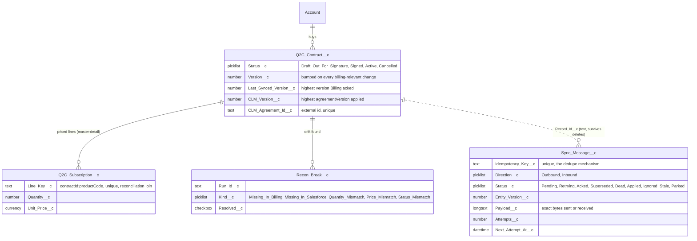

# Design

## Problem

Quote-to-cash state lives in three systems. Salesforce owns the commercial truth (who bought what,
at what price, in what lifecycle state). CLM owns the paper and signatures. Billing owns invoices.
Each of them retries, times out, redelivers, and occasionally gets edited by hand. The integration's
job is to make "Salesforce says X" eventually and provably equal "Billing says X", and to make it
obvious, to a person, when that isn't true yet.

## Data model

`Sync_Message__c.Record_Id__c` is text rather than a lookup on purpose. The audit trail of what was
sent outlives the contract record, and inbound events can arrive for records that don't exist yet.

## Decisions

### 1. Transactional outbox via Platform Events, not callouts from triggers

Triggers can't make callouts, and a callout made before commit can't be taken back if the save rolls
back. The contract trigger publishes `Q2C_Change__e` with **PublishAfterCommit**: the event exists if,
and only if, the save commits. A failed publish adds an error to the record, so the save fails instead
of silently losing the sync.

The subscriber writes the `Sync_Message__c` row (the outbox). Sending happens later, in a Queueable
that is allowed to make callouts.

| Option | Why not |
|---|---|
| `@future(callout=true)` from the trigger | No retry state, no ordering, no visibility; a failure disappears into the Apex jobs log |
| Queueable enqueued straight from the trigger | Rolls back with the save (good), but leaves no durable record of what is owed downstream. A job that exhausts its retries is just gone, and nothing on the contract shows it |
| Change Data Capture | Good for broad replication, but it emits field-level diffs for every change. We want one versioned business event, with a payload we control, only for billing-relevant changes |
| Middleware owns everything | A fine target state. The rules below (versioning, idempotency, reconciliation) are the same either way; this repo keeps them testable inside Salesforce |

### 2. Versions, snapshots, and supersede

`Version__c` increases whenever a billing-relevant field or a priced line changes. Every message
carries a **full snapshot** at one version, never a diff. That one choice makes the rest simple:

- Re-sending is always safe.
- Out-of-order delivery is safe: the target keeps the highest version and answers 409 to an older one.
- Two pending versions for the same (target, contract) collapse to the newest before sending.
- Repair after drift is just "send the current snapshot again".

### 3. Idempotency at both ends

| Duplicate source | Defense |
|---|---|
| Platform Event redelivery | `Idempotency_Key__c` is unique, so the second insert fails with DUPLICATE_VALUE, which we treat as success |
| Our own retries after a timeout | The same key is sent as the `Idempotency-Key` header; the target replays its first response |
| CLM webhook redelivery | `clm-in:<eventId>` key; the duplicate is answered 200 without touching the contract |
| Reconciliation repair | A *fresh* key (`...:repair:<runId>`), on purpose, so the target re-applies instead of replaying |

Because enqueueing is idempotent, the event subscriber can answer any non-duplicate failure by throwing
`EventBus.RetryableException`. Salesforce redelivers the whole batch, and the rows that did succeed
dedupe themselves.

### 4. Retry classification is a pure function

`RetryPolicy.classify(status, timedOut, attempts, max)` → ACK / RETRY / SUPERSEDED / DEAD. It runs
the same vectors in Apex and Python. Backoff doubles from 30s, caps at 1h, and adds jitter in
[base/2, base], so messages that failed together during an outage don't all come back in the same
second.

### 5. Inbound is ordered by the sender's version

Webhooks arrive in any order. Each event carries `agreementVersion`; the contract stores the highest
applied (`CLM_Version__c`). Older events become `Ignored_Stale`. Events that would make an illegal
transition (signing a cancelled contract) are stored as Dead and shown to a person. Applying them
automatically would let a CLM bug rewrite revenue state.

The webhook answers 200 once the event is durably stored, whatever the outcome. A non-2xx would make
the sender retry something we already hold.

### 6. Reconciliation is the backstop, not the mechanism

Even a correct sync drifts: manual edits in Billing, a bug, a restored backup. A nightly Batch job
compares settled contracts (`Last_Synced_Version__c = Version__c`) line by line against Billing's GET.
Each difference becomes a `Recon_Break__c` (the audit trail) and, optionally, a repair message.
In-flight contracts are skipped so the job doesn't report work the outbox is still doing.

### 7. Least privilege for operators

Sync messages are read-only to everyone. The only way to change one is the console's `retry`, which
checks the `Q2C_Sync_Operator` custom permission, runs the update in system mode, and prepends who
re-queued it and when to the error log. Breaks can be resolved in user mode (the permission set
grants that one field).

## Salesforce platform limits this design respects

| Limit | How |
|---|---|
| No callouts in triggers | Outbox + Queueable |
| No callout after uncommitted DML | Dispatcher and reconciliation do every callout first, then all DML |
| 100 callouts / ~120s cumulative callout time per transaction | Batch capped at 90; the loop stops when time or callouts run low and chains the rest |
| `FOR UPDATE` can't use `ORDER BY` | Lock first, sort and supersede in memory |
| One Queueable chain per job; can't chain in tests | `chain()` skips in tests; a Schedulable sweeper re-kicks the dispatcher |
| Duplicate dispatchers | `AsyncOptions.DuplicateSignature` keeps one queued; concurrent runs are still safe because of row locks and idempotent targets |
| Platform Event trigger retries (max 9) | Retryable only while `retries < 9`; idempotent inserts make redelivery free |
| Batch Apex callouts | `Database.AllowsCallouts`, scope 50 |
| Code coverage gate (75%) | Enforced by `sf project deploy validate --test-level RunLocalTests` in the org CI job |

## Known trade-offs

- **Snapshots cost bytes.** A 500-line contract sends 500 lines for one quantity change. In return,
  the target never has to merge diffs, and repair is free.
- **The CLM direction trusts `agreementVersion`.** If the provider can't supply a monotonic version,
  use `occurredAt` plus `eventId` as a tiebreak and accept the edge cases that come with clocks.
- **Last-writer-wins on the contract.** A rep's edit and a CLM signature racing on the same record are
  serialized by row locks, and the state machine decides. There's no field-level merge.
- **Dead means a person.** There's no automatic retry for 4xx. That's deliberate: a wrong payload
  should stop and be seen, not be retried forever.
